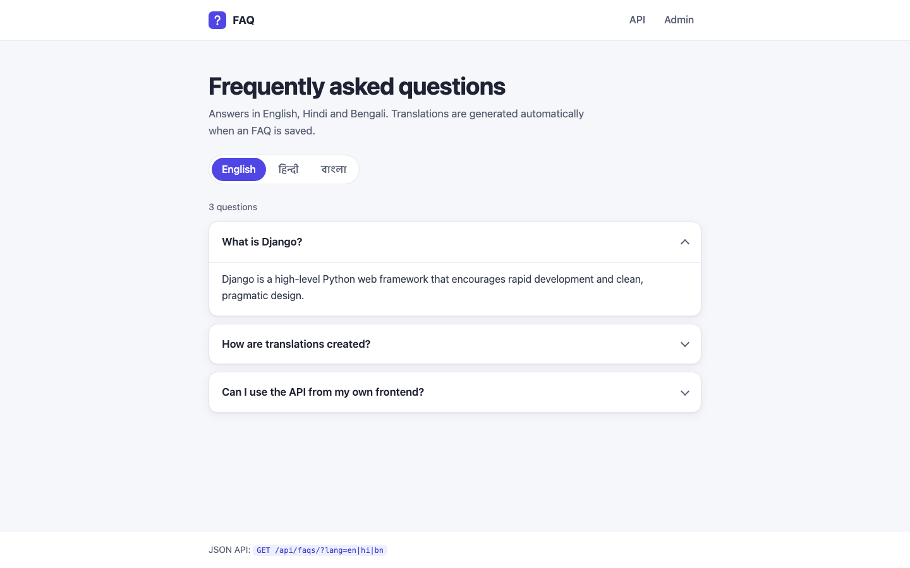
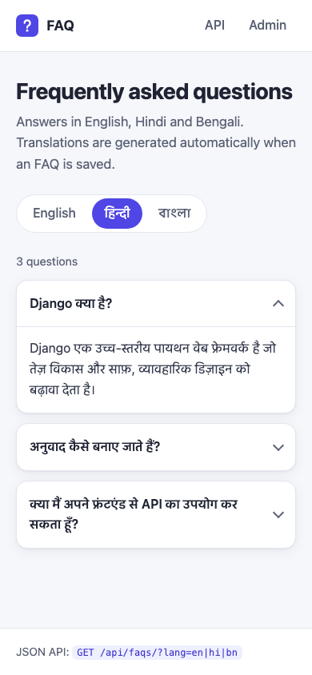
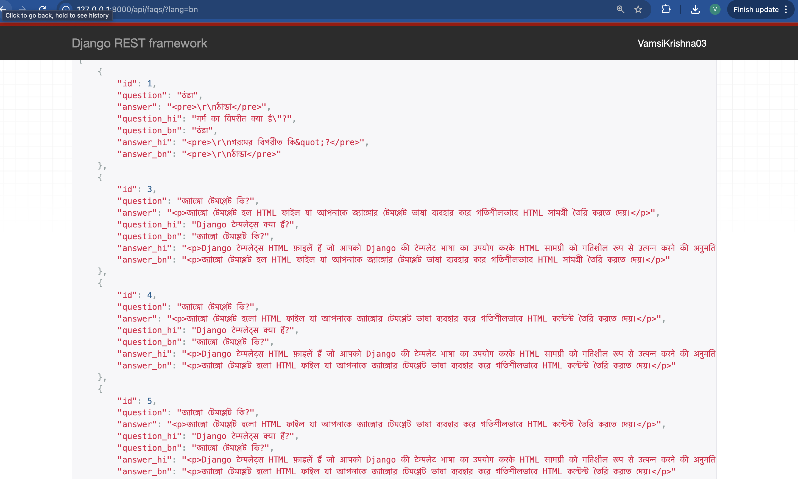

# FAQ Project

A multilingual FAQ API and web page built with Django REST Framework. FAQs are auto-translated into Hindi and Bengali, answers use a CKEditor rich-text editor, and responses are cached (Redis, or in-memory when Redis isn't configured).


[](https://github.com/VamsiKrishnaThota03/faq_project/actions/workflows/ci.yml)
[](https://github.com/VamsiKrishnaThota03/faq_project/actions/workflows/codeql.yml)
[](LICENSE)

## Overview

Admins create FAQs in the Django admin. Answers are edited with a CKEditor WYSIWYG field. When an FAQ is saved, any empty Hindi (`hi`) or Bengali (`bn`) version of the question and answer is filled in automatically through `deep-translator`'s Google Translator. A public, read-only REST endpoint and a small web page return the FAQs in the language you ask for. Results are cached per language and the cache is cleared whenever an FAQ is created, edited or deleted.



## Features

- **FAQ model** with `question`, a rich-text `answer` (CKEditor), and `question_hi`, `question_bn`, `answer_hi`, `answer_bn`
- **Automatic translation on save**: only empty translation fields are filled, so manual edits are kept. If you change the English text, translations you didn't edit are regenerated. If the translator is unreachable the field stays empty, English is shown, and translation is retried on the next save.
- **Language selection** with `?lang=hi` or `?lang=bn`. In the response, `question` and `answer` are replaced with the translated text. Any other value, or no value, returns English.
- **Web page** at `/` with a language switcher, an accordion of questions, and an empty state
- **Caching** of each language's list (`faqs_<lang>`, 15 minutes by default) in Redis when `REDIS_URL` is set, otherwise in local memory. Saving or deleting an FAQ clears it.
- **HTML sanitising**: rich-text answers are cleaned with `nh3` (no scripts or event handlers) before they are returned
- **Django admin** with search and separate English / Translations sections
- **Tests** for translation, fallbacks, caching, sanitising and the API, with the translator mocked so no network is needed
- **Gunicorn `Procfile`** and WhiteNoise static files for platforms such as Render or Heroku

## Tech stack

- Python, Django 5.2 LTS, Django REST Framework 3.16
- django-ckeditor 6.7
- deep-translator (Google Translator backend)
- Redis with django-redis (optional)
- nh3 (HTML sanitising), WhiteNoise (static files), python-dotenv
- SQLite (default database)
- Gunicorn

## Project structure

```
.
├── faq/
│   ├── models.py        # FAQ model + translate-on-save logic
│   ├── views.py         # FAQListView (cached, language-aware) + home page
│   ├── signals.py       # clears the cache when FAQs change
│   ├── templates/faq/   # home page
│   ├── static/faq/      # CSS + favicon
│   ├── serializers.py
│   ├── urls.py          # /api/faqs/
│   ├── admin.py
│   ├── tests.py
│   └── migrations/
├── faq_project/
│   ├── settings.py      # reads configuration from env vars / .env
│   └── urls.py          # admin/, api/, /
├── docs/screenshots/
├── images/              # older screenshots
├── .env.example
├── manage.py
├── requirements.txt
└── Procfile
```

## Getting started

### Prerequisites

- Python 3.10+ (Django 5.2 requires it)
- Optional: a Redis server (otherwise an in-memory cache is used)
- Internet access, which the Google Translator service needs when FAQs are saved

### Install

```bash
git clone https://github.com/VamsiKrishnaThota03/faq_project.git
cd faq_project

python3 -m venv venv
source venv/bin/activate          # Windows: venv\Scripts\activate
pip install -r requirements.txt
cp .env.example .env              # then edit .env
```

For local development put `DJANGO_DEBUG=true` in `.env`. With debug on, a dev-only secret key is used if `DJANGO_SECRET_KEY` is empty. With debug off the app refuses to start without `DJANGO_SECRET_KEY`.

### Environment variables

| Variable | Required | Default | Purpose |
|----------|----------|---------|---------|
| `DJANGO_SECRET_KEY` | yes, unless `DJANGO_DEBUG=true` | none | Django secret key. Generate one with `python -c "import secrets; print(secrets.token_urlsafe(50))"` |
| `DJANGO_DEBUG` | no | `false` | `true` for local development only |
| `DJANGO_ALLOWED_HOSTS` | no | `localhost,127.0.0.1` | Comma-separated host names, e.g. `faq-project.onrender.com` |
| `DJANGO_CSRF_TRUSTED_ORIGINS` | for HTTPS admin logins behind a proxy | empty | Comma-separated origins, e.g. `https://faq-project.onrender.com` |
| `DJANGO_SECURE_COOKIES` | no | `true` when debug is off | Set `false` only to test a non-debug build over plain HTTP |
| `REDIS_URL` | no | empty (memory cache) | e.g. `redis://127.0.0.1:6379/1` |
| `FAQ_CACHE_TIMEOUT` | no | `900` | Cache lifetime in seconds |
| `SQLITE_PATH` | no | `./db.sqlite3` | SQLite database file |

### Database and admin user

```bash
python manage.py migrate
python manage.py createsuperuser
```

### Run

```bash
python manage.py runserver        # listens on 127.0.0.1:8000
```

- Web page: <http://127.0.0.1:8000/>
- API: <http://127.0.0.1:8000/api/faqs/>
- Admin: <http://127.0.0.1:8000/admin/>

### Tests

```bash
DJANGO_DEBUG=true python manage.py test faq
```

### Deploying (Render, Heroku)

- Build command: `pip install -r requirements.txt && python manage.py collectstatic --noinput && python manage.py migrate`
- Start command: `gunicorn faq_project.wsgi` (from the `Procfile`)
- Set `DJANGO_SECRET_KEY`, `DJANGO_ALLOWED_HOSTS` and `DJANGO_CSRF_TRUSTED_ORIGINS`, and optionally `REDIS_URL`.

## API

| Method | Path          | Query            | Purpose                                                  |
|--------|---------------|------------------|----------------------------------------------------------|
| GET    | `/`           | `lang=hi`, `lang=bn` (optional) | Web page listing the FAQs in the chosen language |
| GET    | `/api/faqs/`  | `lang=hi`, `lang=bn` (optional) | List all FAQs, with `question` and `answer` in the requested language (read-only) |
| GET    | `/admin/`     |                  | Django admin for managing FAQs                           |

```bash
curl http://localhost:8000/api/faqs/            # English (default)
curl http://localhost:8000/api/faqs/?lang=hi    # Hindi
curl http://localhost:8000/api/faqs/?lang=bn    # Bengali
```

Example response (`?lang=hi`):

```json
[
  {
    "id": 1,
    "question": "Django क्या है?",
    "answer": "Django एक वेब फ्रेमवर्क है।",
    "question_hi": "Django क्या है?",
    "question_bn": "Django কী?",
    "answer_hi": "Django एक वेब फ्रेमवर्क है।",
    "answer_bn": "Django একটি ওয়েব ফ্রেমওয়ার্ক।"
  }
]
```


## Screenshots

### Home page (mobile, Hindi)


### Admin page


### Translations




## Known limitations

- `django-ckeditor` bundles CKEditor 4, which is no longer supported upstream and has unfixed security issues (Django prints warning `ckeditor.W001`). Only staff use the editor, and answers are sanitised on output, but moving to `django-ckeditor-5` or another editor is recommended.
- Translation uses the free Google Translate endpoint through `deep-translator`. It can be rate-limited, and it runs synchronously when an FAQ is saved.
- Only Hindi and Bengali are supported. Adding a language needs new model fields and a migration.
- The API returns every FAQ in one response (no pagination).

## Contributing

1. Fork the repository and create a branch (`git checkout -b feature-xyz`).
2. Make your changes and run `DJANGO_DEBUG=true python manage.py test faq`.
3. Follow PEP 8, then open a pull request.


## Deployment security

`python manage.py check --deploy` reported `SECURE_HSTS_SECONDS` and
`SECURE_SSL_REDIRECT` as unset (`security.W004`, `security.W008`). Both are now
configured, along with `SESSION_COOKIE_HTTPONLY`, `SameSite=Lax` on both
cookies, `SECURE_CONTENT_TYPE_NOSNIFF`, `X_FRAME_OPTIONS = DENY` and
`SECURE_REFERRER_POLICY`.

They sit inside `if not DEBUG` and each is overridable by an environment
variable, deliberately: **enabling HSTS is effectively irreversible** for the
length of `max-age`, because a browser that has seen the header refuses plain
HTTP to that host until it expires. Someone deploying onto a plain-HTTP host
needs to turn it off up front rather than discover the lockout afterwards.

| Variable | Default | Notes |
| --- | --- | --- |
| `DJANGO_SSL_REDIRECT` | `true` | Set `false` behind a proxy that already redirects |
| `DJANGO_HSTS_SECONDS` | `31536000` | Set `0` to disable |
| `DJANGO_HSTS_INCLUDE_SUBDOMAINS` | `true` | |
| `DJANGO_HSTS_PRELOAD` | **`false`** | Left off on purpose — browser preload submission is permanent |
| `DJANGO_SECURE_COOKIES` | `true` | Set `false` only for plain-HTTP local runs |

`check --deploy` is now completely clean. The resulting `W021` preload warning
is acknowledged via `SILENCED_SYSTEM_CHECKS`, scoped to that single check and
**conditional** — it disappears the moment `DJANGO_HSTS_PRELOAD=true` is set.
Acknowledging it beats leaving a standing warning, because a check that always
prints something trains everyone to stop reading it.

CI runs `check --deploy --fail-level WARNING`, so any genuinely new warning
fails the build, and a second step enables preload to prove the silence is
conditional rather than a blanket suppression.

## Continuous integration

| Job | What it proves |
| --- | --- |
| `test` (Python 3.11, 3.12) | `manage.py check`, that no migration is missing (`makemigrations --check`), and the test suite |
| `deploy-check` | `check --deploy --fail-level WARNING` is clean, and a missing `DJANGO_SECRET_KEY` stops the app rather than falling back to the insecure local key |
| `docker` | The image builds |

CodeQL runs over Python weekly and on every push; Dependabot watches pip,
Actions and the Dockerfile.

## Docker

```bash
printf 'DJANGO_SECRET_KEY=%s\n' \
  "$(python3 -c 'import secrets;print(secrets.token_urlsafe(64))')" > .env

docker compose up --build
open http://localhost:8000
```

Runs under gunicorn as a non-root user, with static files collected at build
time so the container needs no write access to the image. The port publishes to
`127.0.0.1` only; gunicorn binds all interfaces *inside* the container, which is
correct — the publish is the security boundary.
