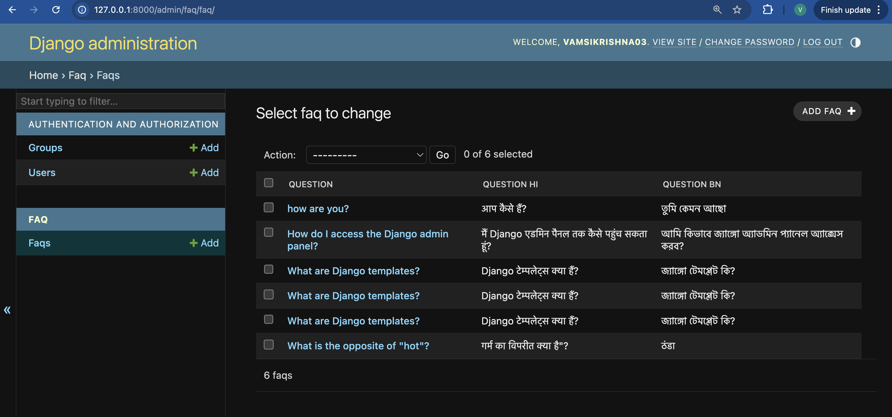
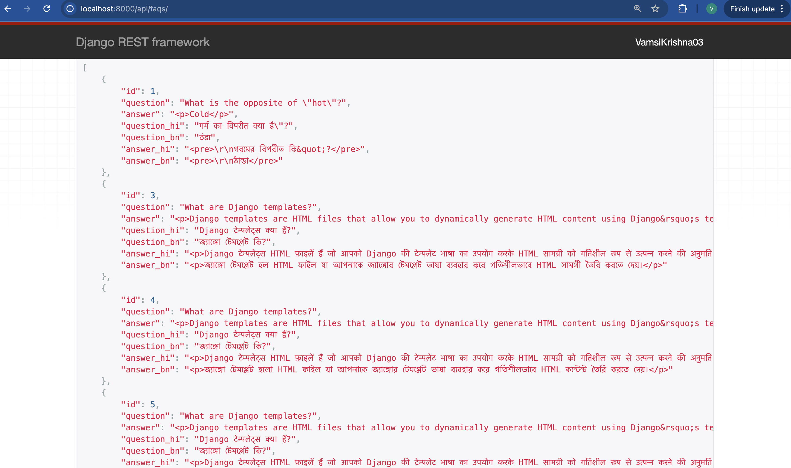
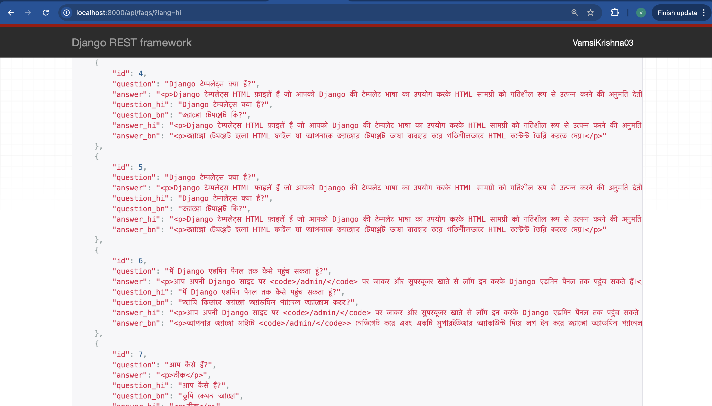

# FAQ Project

A multilingual FAQ API built with Django REST Framework. FAQs are auto-translated into Hindi and Bengali, answers use a CKEditor rich-text editor, and responses are cached in Redis.


## Overview

Admins create FAQs in the Django admin. Answers are edited with a CKEditor WYSIWYG field. When an FAQ is saved, any missing Hindi (`hi`) or Bengali (`bn`) versions of the question and answer are filled in automatically through `deep-translator`'s Google Translator. If translation fails, the original text is kept. A public REST endpoint returns the FAQs in the language you request, and caches the result in Redis for 15 minutes per language.

## Features

- **FAQ model** with `question`, a rich-text `answer` (CKEditor), and `question_hi`, `question_bn`, `answer_hi`, `answer_bn`
- **Automatic translation on save**: only empty translation fields are filled, so manual edits are kept
- **Language selection** with `?lang=hi` or `?lang=bn`. In the response, `question` and `answer` are replaced with the translated text. Any other value, or no value, returns English.
- **Redis caching** with `django-redis`, cache key `faqs_<lang>`, 15-minute timeout
- **Django admin** listing questions with their Hindi and Bengali versions
- **CKEditor upload URLs** mounted at `/ckeditor/`
- **Unit test** that checks translated fields are returned by the model helpers
- **Gunicorn `Procfile`** for platforms such as Render or Heroku

## Tech stack

- Python, Django 5.1, Django REST Framework 3.15
- django-ckeditor 6.7
- deep-translator (Google Translator backend)
- Redis with django-redis
- SQLite (default database)
- Gunicorn

## Project structure

```
.
├── faq/
│   ├── models.py        # FAQ model + translate-on-save logic
│   ├── views.py         # FAQListView (cached, language-aware) + home view
│   ├── serializers.py
│   ├── urls.py          # /api/faqs/
│   ├── admin.py
│   ├── tests.py
│   └── migrations/
├── faq_project/
│   ├── settings.py      # Apps, Redis cache, SQLite, allowed hosts
│   └── urls.py          # admin/, ckeditor/, api/, /
├── images/              # README screenshots
├── manage.py
├── requirements.txt
└── Procfile
```

## Getting started

### Prerequisites

- Python 3.10+ (Django 5.1 requires it)
- A Redis server running on `127.0.0.1:6379`
- Internet access, which the Google Translator service needs when FAQs are saved

### Install

```bash
git clone https://github.com/VamsiKrishnaThota03/faq_project.git
cd faq_project

python3 -m venv venv
source venv/bin/activate          # Windows: venv\Scripts\activate
pip install -r requirements.txt
```

### Configuration

The project does not read environment variables yet (`load_dotenv()` is commented out in `settings.py`). These values are set directly in `faq_project/settings.py`:

| Setting          | Current value                         | What to change for your setup                        |
|------------------|---------------------------------------|------------------------------------------------------|
| `SECRET_KEY`     | placeholder string                    | Set a unique secret, ideally loaded from an env var  |
| `DEBUG`          | `True`                                | Set to `False` in production                         |
| `ALLOWED_HOSTS`  | `localhost`, `127.0.0.1`, a Render host | Add your own domain                               |
| `CACHES.LOCATION`| `redis://127.0.0.1:6379/1`            | Point to your Redis instance                         |

### Database and admin user

```bash
python manage.py migrate
python manage.py createsuperuser
```

### Run

```bash
python manage.py runserver
```

- API: <http://127.0.0.1:8000/api/faqs/>
- Admin: <http://127.0.0.1:8000/admin/>

### Tests

```bash
python manage.py test faq
```

## API

| Method | Path          | Query            | Purpose                                                  |
|--------|---------------|------------------|----------------------------------------------------------|
| GET    | `/`           |                  | Plain-text welcome page                                  |
| GET    | `/api/faqs/`  | `lang=hi`, `lang=bn` (optional) | List all FAQs, with `question` and `answer` in the requested language |
| GET    | `/admin/`     |                  | Django admin for managing FAQs                           |

```bash
curl http://localhost:8000/api/faqs/            # English (default)
curl http://localhost:8000/api/faqs/?lang=hi    # Hindi
curl http://localhost:8000/api/faqs/?lang=bn    # Bengali
```

Example response (`?lang=hi`):

```json
[
  {
    "id": 1,
    "question": "Django क्या है?",
    "answer": "Django एक वेब फ्रेमवर्क है।",
    "question_hi": "Django क्या है?",
    "question_bn": "Django কী?",
    "answer_hi": "Django एक वेब फ्रेमवर्क है।",
    "answer_bn": "Django একটি ওয়েব ফ্রেমওয়ার্ক।"
  }
]
```

> The cache is not cleared when an FAQ changes, so new or edited FAQs can take up to 15 minutes to appear for a language that is already cached.

## Screenshots

### Admin page


### FAQ page


### Translations



## Contributing

1. Fork the repository and create a branch (`git checkout -b feature-xyz`).
2. Make your changes and run `python manage.py test`.
3. Follow PEP 8, then open a pull request.
